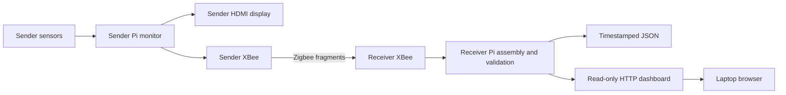

> Current live-transport release - 11 November 2026: see [UPGRADE_NOTES.md](UPGRADE_NOTES.md) for the owner-requested version folders, source synchronization, baud settings and final verification. Both modules and apps use 115200 baud; live v2 batches replace full-wave snapshots. Historical 9600-baud/5-second/60-second figures below describe earlier stages, not the active release. The current protocol is [ZIGBEE_PROTOCOL.md](ZIGBEE_PROTOCOL.md).

# Immortals Zigbee receiver

The receiver Pi collects wireless sensor snapshots from the Immortals sender Pi,
validates and reconstructs them, and serves a read-only dashboard to the laptop.
No sensors are acquired on this Pi, and no receiver software is installed on the
sender Pi. The original terminal receiver is preserved under `reference/`.

## Access and locations

| Item | Value |
|---|---|
| Receiver SSH | `ssh pi@immortals-recv.local` |
| Observed receiver IPv4 | `192.168.0.152` (DHCP; hostname preferred) |
| Browser dashboard | <http://immortals-recv.local:8080> |
| JSON API | <http://immortals-recv.local:8080/api/readings> |
| Receiver project | `/home/pi/Desktop/Immortals_Receiver` |
| Receiver runtime | `/home/pi/Desktop/Immortals_Receiver/.venv/bin/python` |
| Laptop source | `D:\PROJECTS\Immortals\Receiver` |
| Boot service | `immortals-receiver.service` |
| Sender project | `/home/pi/Desktop/Immortals_Monitor` on the other Pi |
| Sender SSH | `ssh pi@192.168.137.88` (laptop hotspot) |
| Credential document | `D:\PROJECTS\Immortals\.work\PI_ACCESS.md` |

The owner requested that both SSH logins and passwords be recorded. The access
document above contains them and stays on the laptop; it is not served over HTTP
or included in either Pi's synchronized application source. Sender and receiver
SSH identities are separately pinned by the deployment helpers.

The laptop must be able to reach the receiver's LAN. The sender currently uses
the laptop hotspot. Sensor data travels between the Pis over Zigbee; the Pis do
not need to share a Wi-Fi network. The laptop connects to the receiver by HTTP.

## Files

| File | Purpose |
|---|---|
| `main.py` | RF assembly, validation, freshness, radio worker, JSON API and HTTP service |
| `dashboard.html` | Responsive laptop/mobile dashboard with sensor cards and waveform snapshots |
| `receiver.py` | Compatibility entry point for the old receiver command |
| `receiver_config.json` | USB path, radio identities, HTTP binding and freshness limits |
| `requirements.txt` | Digi XBee 1.5.0 and pyserial 3.5 |
| `immortals-receiver.service` | Systemd boot service running as user `pi` |
| `tests/test_receiver.py` | Receiver protocol, freshness, restart and HTTP tests |
| `reference/receiver.py` | Unchanged original text receiver |
| `ZIGBEE_PROTOCOL.md` | Shared sender/receiver wire contract |
| `source-sha256.json` | Source synchronization manifest |
| `latest_readings.json` | Automatically refreshed receiver state and safe display snapshot |
| `last_packet.json` | Exact last decoded packet, including original ages and waveforms; diagnostic archive only |
| `logs/receiver.log` | Rotating log, up to three files of about 512 KB each |

Source is synchronized and hash-verified at delivery. Live data, logs and Linux
virtual environments are machine-specific. There is no continuous two-way sync.

## Hardware and protocol

- Sender radio: `0013A200408DF0F0`; receiver: `0013A200408DF0CE`.
- Receiver USB path: `/dev/serial/by-id/usb-Silicon_Labs_CP2102_USB_to_UART_Bridge_Controller_0001-if00-port0`.
- Radio serial: 9600 baud, 8N1, API mode. Existing network settings were retained.
- Both radios reported operating PAN `0x0C001BEE`, channel `0x16`, joined status
  `AI=0`, and `NP=255`. The sender uses RF packets of at most 200 bytes.
- The runtime was verified on this receiver's Python 3.13.5; the sender retains
  its separate Python 3.11 environment.



The old receiver decoded every RF packet as UTF-8 text. That cannot decode the
sender's compressed binary fragments. The new receiver accepts only the configured
sender address, checks the 20-byte `IM` header, reassembles by session and sequence,
verifies whole-message CRC32, decompresses the payload, and validates the JSON.
It supports out-of-order fragments and identical duplicates, rejects conflicting
duplicates/corruption, and drops incomplete assemblies after 60 seconds. At most
four assemblies of 64 KiB compressed each are retained; JSON decompression is
limited to 256 KiB. No partial message is presented as a sensor reading.

All sensor groups are retained: pulse/MAX30102, ECG/ADS1115, BMP180, MLX90614,
and DHT22. The cards show heart rate, estimated SpO2, surface/ambient/room/board
temperatures, humidity, and pressure. The expandable measurement table includes
the remaining values and statuses. Both transmitted graph arrays are rendered.
Qualified ECG bpm and provisional `candidate_bpm` remain separate; a provisional
rate is prefixed with `~` and labelled **UNRELIABLE**. Missing values remain `--`.

## Timing and stale data

The sender aims to begin a snapshot every five seconds, but the existing 9600-baud
radio configuration takes approximately 15-19 seconds to deliver a complete
snapshot containing the full eight-second waveforms. Large snapshots take longer
than scalar-only telemetry. This receiver does not claim continuous real-time
ECG recording. It displays both capture age and time since receipt.

The receiver's default freshness limit is **60 seconds**, chosen after measuring
the full waveform transfer time. Original sensor age is added to transmission age
and subsequent local monotonic elapsed time. A sensor older than the limit has
its numbers and waveform cleared. Once the complete snapshot is too old, the badge
shows **SENDER DATA STALE**. The limit can be changed in `receiver_config.json`.

The sender already removes sensor data that fails its own acquisition freshness
checks before transmission. Receipt never makes a stale source reading fresh.
Both Pi clocks must be synchronized: packets over five seconds in the future
are rejected, and packets already over the freshness limit are not accepted.
After receipt, monotonic time makes expiry independent of wall-clock corrections.

Older/duplicate sequences are discarded, including sequence wrap handling. A new
sender session retires the previous session; late packets cannot restore its
display. On receiver startup the dashboard waits for a new RF packet. It never
loads the old disk packet as live data. `last_packet.json` is retained for
diagnostics only; consumers should use `/api/readings` or `latest_readings.json`
and check receiver state and timestamps.

If the browser loses its connection, it clears the displayed data and shows
**RECEIVER UNREACHABLE**. HTTP requests time out after four seconds and are retried.
This is distinct from the sender being OFF while the receiver service remains up.

## Startup and operation

The installed system service runs at boot, without a desktop session or terminal:

```bash
sudo systemctl status immortals-receiver.service
sudo systemctl restart immortals-receiver.service
journalctl -u immortals-receiver.service -n 40 --no-pager
```

Open the dashboard from the laptop, then tap **Zigbee: ON** on the sender screen.
Turning the sender OFF stops subsequent RF packets without stopping its sensors
or screen. The receiver will expire the last snapshot. Turning ON resumes receipt
without restarting the receiver. A packet already handed to the sender radio may
complete after OFF.

To run a bounded receiver diagnostic manually, stop the service first:

```bash
sudo systemctl stop immortals-receiver.service
cd /home/pi/Desktop/Immortals_Receiver
.venv/bin/python main.py --seconds 30
sudo systemctl start immortals-receiver.service
```

The app has a process lock, and the SDK opens USB exclusively. Starting the old
`/home/pi/xbee_project/receiver.py` or its nested duplicate now invokes the same
new app; if the service is already running, it reports that instead of competing
for the radio. Original sources and their old environments are preserved.

USB or association failure affects the radio worker; the HTTP dashboard remains
available and shows the error. The worker closes the port and retries after three
seconds. Serial operations use two-second timeouts. Initial opening performs
several operations and may take longer. Service failures are restarted by systemd.

## Rebuild and tests

```bash
cd /home/pi/Desktop/Immortals_Receiver
python3 -m venv .venv
.venv/bin/python -m pip install -r requirements.txt
.venv/bin/python -m unittest discover -s tests -v
sudo install -m 644 immortals-receiver.service /etc/systemd/system/
sudo systemctl daemon-reload
sudo systemctl enable --now immortals-receiver.service
```

The service runs as `pi`, which must have serial/dialout access. Port 8080 is bound
to the LAN for the laptop dashboard. The HTTP server has only read endpoints; it
does not expose project files, credentials, or device-control commands.

## Backups and verification

The original receiver source was archived before editing:
`/home/pi/.local/share/immortals-backups/receiver-20261111-100508/original-receiver.tar.gz`.
SHA-256: `ff0ddc9fb7eefe47b976438d78ab2a553be3fd0cd3cdcf8b432ac29d28fa9ccd`.
The laptop backup is `.work/pi-backup/original-receiver.tar.gz`.

On 11 November 2026, all 18 receiver automated tests passed on both Windows and
the receiver's own runtime. Real RF snapshots were reconstructed with zero invalid
frames during the captured run. The user performed a finger test: four captured
receiver sequences (36-39) contained optical heart rate 82.5-87.0 bpm, estimated
SpO2 98.4-99.7%, and 200-201 pulse waveform points; ECG snapshots contained about
1,000 points. The provisional ECG rate remained separate and explicitly unreliable.
These tests establish transport and display, not clinical calibration.

After finger removal, a later received packet contained null heart rate/SpO2 and
an empty pulse waveform. The browser display was visually checked with real RF
data. Evidence is retained on the laptop in `.work/receiver-finger-validation.json`,
`.work/receiver-finger-removed.json`, and `output/playwright/receiver-finger.png`.

The final shutdown, restart, browser and boot verification results are recorded
in the delivery verification section below.


## Delivery verification

- Real sender screen OFF/ON was exercised against the running receiver. During OFF,
  sender optical acquisition advanced from 25,910 to 30,851 samples with no FIFO
  overflow. The receiver cleared all stale numbers and graph arrays; ON resumed
  complete fresh packets without restarting the receiver. Captures are in
  `.work/receiver-off-validation.json` and `.work/receiver-resumed.json`.
- Browser offline mode cleared every card and waveform and showed RECEIVER
  UNREACHABLE. Restoring the browser network resumed live readings automatically.
- The receiver Pi was actually rebooted. Its kernel boot ID changed, the installed
  service started automatically, and two new RF snapshots were decoded within
  about 67 seconds of the reboot request. Post-boot packets had zero invalid frames.
  Evidence is in `.work/receiver-boot-validation.json`. Initial radio timeouts were
  retried automatically; no manual receiver restart was needed after boot.
- The original receiver command now reports that the service is already running,
  avoiding a second radio owner. `systemd-analyze verify` accepted the installed
  service definition, and the radio is owned by the service process.
- The actual browser was checked at 1280 x 900 and 390 x 844. Neither layout had
  horizontal overflow. A fresh final browser session had no console errors.
  Screenshots are under `output/playwright/receiver-final-desktop.png` and
  `output/playwright/receiver-final-mobile.png`; earlier captures show the finger,
  sender-OFF stale state and browser-offline state.
- All ten receiver source/configuration/documentation/test files and their manifest
  match the laptop copy. Sender source remains separately synchronized. Old receiver
  and sender source backups remain available. Login credentials are in the
  laptop-only access document listed above.

Both Pis are left running, the sender Zigbee button is ON, and the receiver is
receiving. The receiver service starts at boot. The sender retains its existing
startup policy: its dashboard starts at desktop login, and Zigbee starts OFF
until the user enables it.
