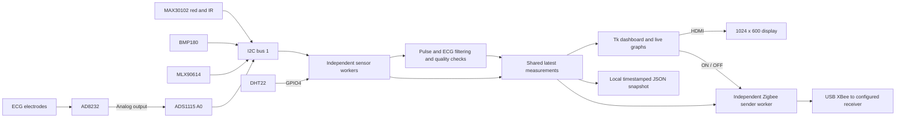
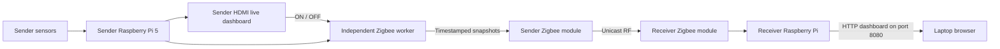

> Current live-transport release - 11 November 2026: see [UPGRADE_NOTES.md](UPGRADE_NOTES.md) for the owner-requested version folders, source synchronization, baud settings and final verification. Both modules and apps use 115200 baud; live v2 batches replace full-wave snapshots. Historical 9600-baud/5-second/60-second figures below describe earlier stages, not the active release. The current protocol is [ZIGBEE_PROTOCOL.md](ZIGBEE_PROTOCOL.md).

# Immortals Raspberry Pi Sensor Monitor

> Sender UI update — 11 November 2026: [UI_UPDATE_NOTES.md](UI_UPDATE_NOTES.md)
> describes the deployed patient header, main vitals area, and compact right-side
> environmental cards. Demo patient identifiers are visibly marked as placeholders.

This project collects readings from the sensors attached to the sender Raspberry Pi 5 and displays them on its own 7-inch HDMI screen. The dashboard shows heart rate, estimated blood oxygen saturation, temperatures, humidity, pressure, and pulse and ECG graph areas. The application is self-contained in `main.py`.

The current stage includes local sensing, display, and an independently controlled Zigbee sender. The touchscreen ON/OFF button now starts and stops forwarding sensor values and waveform snapshots to the configured receiver radio. The receiver application is deployed on the separate Pi `immortals-recv.local`, with its laptop dashboard at `http://immortals-recv.local:8080`. Receiver source is retained in the laptop `Immortals_Receiver` folder and is not installed on this sender Pi.

## Project locations and files

| Location | Purpose |
|---|---|
| `/home/pi/Desktop/Immortals_Monitor` | The only active sensor project folder on the Pi desktop |
| `D:\PROJECTS\Immortals\Sender` | Matching source copy on the laptop |
| `main.py` | Complete application: drivers, calculation, scheduling, graphs and dashboard |
| `pi5_sensor_monitor.py` | Compatibility entry point that starts `main.py` |
| `reference/pi5_sensor_monitor.py` | Unchanged copy of the updated script originally in the Pi Downloads folder; retained as reference, not the current app |
| `xbee_project/sender.py` | Preserved original Digi XBee sender addressed to one receiver |
| `xbee_project/sender_broadcast.py` | Preserved broadcast sender formerly at `/home/pi/sender.py` |
| `xbee_project/venv` | Existing Zigbee environment on the Pi, relocated with its paths repaired |
| `.venv` | Prepared sensor runtime on the Pi |
| `requirements.txt` | Versions of the main runtime's direct Python dependencies |
| `xbee_project/requirements.txt` | Digi XBee and serial package versions |
| `zigbee_config.json` | Sender USB path, radio addresses, baud rate and packet timing |
| `ZIGBEE_PROTOCOL.md` | Wireless packet contract, controls and future receiver requirements |
| `tests/` | Sensor regression and Zigbee protocol/concurrency checks |
| `Start Monitor.desktop` | Graphical launcher for the Pi |
| `latest_readings.json` | Automatically refreshed, timestamped measurement snapshot |
| `settings.json` | Optional saved ECG configuration; the delivered configuration enables ECG |
| `logs/monitor.log` | Rotating diagnostic log; maximum three files of about 512 KB each |
| `source-sha256.json` | SHA-256 manifest used to verify the laptop and Pi source copies |

Source files and this document are synchronized between the laptop and Pi at delivery. Linux virtual environments, live readings, logs and runtime settings are machine-specific and are not mirrored to Windows. There is no background two-way synchronization service. The Windows copy is for editing and retention; the attached hardware application runs on the Pi.

## Components and displayed measurements

| Component | Role | Display and units |
|---|---|---|
| Raspberry Pi 5 | Sensor acquisition, processing and user interface | Local dashboard |
| MAX30102 / MH-ET LIVE breakout | Red and infrared optical pulse sensing | Heart rate in bpm, estimated SpO2 in %, relative pulse graph, signal quality |
| AD8232 | ECG analog front end | ECG signal sent to ADS1115 A0 |
| ADS1115 | Converts the AD8232 analog output | Two-second voltage range, filtered ECG graph and qualified ECG heart-rate estimate when pads are enabled |
| BMP180 | Pressure and board temperature | Local atmospheric pressure in hPa and sensor temperature in degrees C |
| DHT22 | Room temperature and humidity | Degrees C and relative humidity in % RH |
| MLX90614 / HW-691 | Infrared temperature | Object/surface temperature and sensor ambient temperature in degrees C |
| Waveshare 7-inch HDMI LCD (C), Rev 4.1 | Local user display | 1024 x 600 pixels; HDMI video and USB touch connection |
| Mouse and keyboard | Dashboard control | Mouse buttons and keyboard shortcuts |
| Sender Zigbee/XBee module | Wireless telemetry controlled by the dashboard | Runs independently of acquisition and display |
| Receiver Zigbee and second Pi | Deployed receiver and HTTP dashboard | `immortals-recv.local:8080` |

SpO2 is blood oxygen saturation, not the oxygen concentration of the surrounding air. The MLX90614 reading is surface temperature, not a calibrated core body temperature. BMP180 pressure is local station pressure; no sea-level correction is applied.

## Wiring and pin mapping

GPIO numbers below use BCM numbering. Physical pin numbers refer to the 40-pin Pi header. All sensors share a common ground. The HDMI screen does not consume the sensor GPIO pins.

### Raspberry Pi header

| Physical pin | BCM/function | Connection |
|---|---|---|
| 1 | 3.3 V | Sensor power rail, subject to the breakout's supported voltage |
| 3 | GPIO2 / SDA1 | ADS1115, MAX30102, BMP180 and MLX90614 SDA |
| 5 | GPIO3 / SCL1 | ADS1115, MAX30102, BMP180 and MLX90614 SCL |
| 6 | GND | Common ground; ADS1115 ADDR also goes to ground |
| 7 | GPIO4 | DHT22 DATA |
| 11 | GPIO17 | Optional AD8232 LO+; not read by the current application |
| 13 | GPIO27 | Optional AD8232 LO-; not read by the current application |
| 15 | GPIO22 | Optional MAX30102 INT; not required by FIFO polling |

### Module connections

| Module | Pin | Connect to |
|---|---|---|
| AD8232 | 3.3V, GND | Pi 3.3 V rail and ground |
| AD8232 | OUTPUT | ADS1115 A0; never connect this analog output directly to a Pi GPIO |
| AD8232 | SDN | 3.3 V, after checking the board revision |
| AD8232 | RA, LA, RL | Compatible electrode cable, following its labels |
| ADS1115 | VDD, GND | 3.3 V and ground |
| ADS1115 | SDA, SCL | GPIO2 and GPIO3 |
| ADS1115 | ADDR | Ground, selecting 0x48 |
| ADS1115 | A0 | AD8232 OUTPUT |
| ADS1115 | A1, A2, A3, ALERT | Unconnected in this project |
| MAX30102 | VIN, GND | 3.3 V and ground; verify breakout supply requirements |
| MAX30102 | SDA, SCL | GPIO2 and GPIO3 |
| MAX30102 | RD, IRD | Leave unconnected; these are not Pi data signals |
| BMP180 | VCC, GND, SDA, SCL | 3.3 V, ground, GPIO2, GPIO3 |
| DHT22 | VCC, DATA, GND | 3.3 V, GPIO4, ground |
| DHT22 | NC, if present | Unconnected |
| MLX90614 | VIN, GND, SDA, SCL | 3.3 V, ground, GPIO2, GPIO3; verify breakout supply requirements |
| HDMI screen | HDMI | Pi HDMI output |
| HDMI screen | USB touch | Pi USB, as connected |
| Mouse and keyboard | USB | Pi USB ports |

The supplied MAX30102 board orientation has top-row labels GND, RD, IRD, INT and bottom-row labels VIN, SDA, SCL, GND. Always follow the printed pin labels. A bare four-pin DHT22 normally needs a 4.7-10 kOhm resistor from DATA to 3.3 V; a three-pin breakout may already include it.

### I2C devices

| Device | Bus | Address | Observed identity |
|---|---|---|---|
| ADS1115 | `/dev/i2c-1` | `0x48` | Conversion/configuration registers respond |
| MAX30102 | `/dev/i2c-1` | `0x57` | Part ID `0x15` |
| MLX90614 | `/dev/i2c-1` | `0x5A` | Ambient/object temperature registers respond |
| BMP180 | `/dev/i2c-1` | `0x77` | Chip ID `0x55` |

## Current architecture



The GUI runs on the main thread and refreshes about five times per second. Separate workers handle MAX30102, ECG, BMP180 and MLX90614. DHT22 bit-banging runs in a separate spawned Python process so its timing loop cannot hold the ECG process's Python execution lock. The parent receives DHT results through a bounded queue. Starting `main.py` manages this child automatically; no second file or manual command is needed. Each I2C worker owns its bus handle, and the Linux I2C driver serializes transactions. A separate worker writes the latest JSON snapshot once per second.

The MAX30102 takes 100 conversions per second and averages four conversions into each FIFO sample, giving a nominal 25 paired samples per second. The driver retains every red/IR pair, reads frequently, and clears the analysis window after data gaps or FIFO overflow. It uses an eight-second window, band-pass filtering, period estimation, peak-spacing checks and agreement between the red and IR signals. It calculates SpO2 from their AC/DC ratio using `-45.060 * R^2 + 30.354 * R + 94.845`. This common reference approximation has not been clinically calibrated for this breakout.

The supported pulse estimation range is approximately 40-220 bpm. SpO2 estimates outside 70-100% or outside the accepted ratio range are withheld. A weak, moving, saturated, disconnected or inconsistent signal produces `--` and an explanatory status. Values are not forced into a normal range. Finger removal clears the pulse window immediately. Data older than three seconds is withheld; the DHT freshness limit is seven seconds. A brief DHT checksum retry retains the previous valid reading with its original timestamp and an explicit age message; it never marks that older reading as freshly measured.

ADS1115 uses A0 with gain 1, a +/-4.096 V conversion range and 250 conversions per second. Software reads at up to 125 Hz using actual timestamps. The graph header shows the voltage range over about two seconds, rather than one instant that may happen to be zero. The JSON includes the latest voltage, minimum, maximum and percentage of near-rail samples. This graph is an input display, not a diagnostic ECG recorder. The program does not infer ECG heart rate from an unconnected input. A rolling input check identifies clipping at the supply rails, nearly flat input and excessive movement/noise, with the status shown below the trace. Because optional lead-off pins are not assumed to be wired, the ECG pad state is a manual control, not automatic electrode detection.

ECG processing resamples the real timestamps, applies a 50 Hz notch and 0.5-35 Hz band-pass filter, then identifies QRS energy in the 5-20 Hz band. A qualified heart rate is reported only when input quality, beat timing, waveform similarity and energy concentration agree. At the user's request, if at least four candidate peaks are detected but quality checks fail, the panel can still show their calculated rate as `~NN bpm` with an **UNRELIABLE** status. This provisional detected-peak rate is stored separately as `candidate_bpm`; `heart_rate_bpm` stays null when unqualified. It can reflect interference or movement and is not evidence of a correct heart rate. No number is invented when peaks cannot be detected or the sampling is interrupted.

The graph displays the actual filtered AD8232 output in millivolts with a labelled changing scale and the signal-quality status. It is not a calibrated skin-level ECG voltage or an artificially drawn heartbeat. The ECG panel shows its own bpm value. The top-left heart-rate card always uses MAX30102, as requested; it never substitutes an ECG reading. Optical heart rate and SpO2 require a finger on MAX30102, while ECG bpm remains separate in the lower panel.

## Zigbee sender and receiver architecture



The existing capsule at the bottom-right now controls the real backend. It starts OFF, leaving the serial port closed. ON starts the sender worker while acquisition and local graphs continue. OFF stops subsequent packets, discards unfinished snapshots and closes the port after any operation already in progress. A packet already handed to the radio cannot be recalled. The button remains a persistent native control with the previously verified borderless window positioning.

ON is green while enabled and becomes amber after a link error. The neighbouring text reports connection, sending or delivery status; OFF is slate blue. This means an enabled sender is not automatically evidence of receiver delivery. The latest JSON contains a `zigbee` section with delivery counters, last error and acknowledgement timestamp. Ordinary desktop startup always resets sending to OFF.

The sender uses the same Digi XBee library, 9600 baud and destination `0013A200408DF0CE` as the proven addressed script. Its own radio is `0013A200408DF0F0`. A stable USB by-id path avoids reliance on ttyUSB numbering. Settings are in `zigbee_config.json`; the app reads them when connecting and verifies the attached sender identity. No module settings were changed. The preserved manual senders remain unchanged and must not run while the dashboard owns the port.

Every wireless snapshot includes all current displayed sensor measurements, their units/status/age, separate qualified and provisional ECG rates, and up to eight seconds of the pulse and filtered ECG graphs. Missing data stays missing. Snapshots are compressed and fragmented into bounded RF packets with session/sequence identifiers and a whole-message CRC. The target snapshot interval is five seconds; large waveforms or slow radio delivery can take longer. There is no transmission backlog, and failures discard the old batch before retrying with fresh data.

See [ZIGBEE_PROTOCOL.md](ZIGBEE_PROTOCOL.md) for byte offsets, JSON fields, timing, receiver reconstruction requirements and tests. The deployed `Immortals_Receiver` application now understands this framing and replaces the original plain-text receiver on the separate receiver Pi. No receiver app is installed on this sender Pi. End-to-end RF delivery, reconstruction, and browser display were verified after the owner supplied receiver SSH access. Full waveform snapshots take approximately 15-19 seconds at 9600 baud; the receiver displays capture age and expires old measurements after 60 seconds.

## Environment and startup

The deployed Pi uses Raspberry Pi OS / Debian 12 Bookworm, 64-bit, and Python 3.11. The prepared `.venv` includes system packages. Tkinter, NumPy, SciPy, smbus2 and Pi GPIO dependencies have been verified in that environment. Do not copy a Windows virtual environment to the Pi.

### Normal manual start

Run this in a terminal on the Pi desktop:

```bash
cd /home/pi/Desktop/Immortals_Monitor
source .venv/bin/activate
python main.py
```

This one Python file starts all sensor acquisition and the dashboard. `main.py` also selects the prepared project environment if launched with system Python. It does not install packages on startup. Running `python pi5_sensor_monitor.py` starts the same app. The original Downloads code under `reference/` is retained only for comparison.

The dashboard starts automatically at desktop login through `/home/pi/.config/autostart/immortals-monitor.desktop`. The desktop session must be running; this is a graphical login startup, not a headless boot service. The installed file is a copy of `Start Monitor.desktop`. Double-clicking that launcher inside the project folder also starts the dashboard. A process lock prevents two instances from competing for the sensors. If the automatically started app is already visible, it is not necessary to run it again.

### Dashboard controls

- F11 or **Full screen** toggles fullscreen. Escape returns to a window.
- The **X** button or Ctrl+Q closes the monitor and releases the sensors.
- Place a fingertip gently over both MAX30102 LEDs and keep the hand still. Allow at least eight seconds of good contact for a value.
- ECG stays enabled in the lower panel for comparison. There is no ECG control in the footer. The saved configuration does not detect electrode attachment or provide electrical isolation; body-connected testing still requires the appropriate isolated arrangement.
- `--` means a reading is not available or did not pass the signal checks.
- Tap **Zigbee: OFF / ON** to stop/start sending. Amber ON and **Link error - retrying** indicate an enabled sender with a radio/delivery error. Local measurements continue in either state.

### Diagnostic start

Close the dashboard first so there is only one hardware owner:

```bash
cd /home/pi/Desktop/Immortals_Monitor
source .venv/bin/activate
python main.py --headless --seconds 20
```

This bounded diagnostic prints engineering values and statuses. The normal dashboard does not need a terminal. Logs are in `logs/monitor.log`; the latest readings are in `latest_readings.json`. On a clean shutdown the snapshot is marked `Monitor stopped` and its measurement values are removed. External consumers must also check the snapshot timestamp in case of power loss.

### Rebuilding the environment if the Pi is reinstalled

This is a recovery procedure; the current environment is already prepared:

```bash
sudo apt update
sudo apt install python3-venv python3-tk python3-numpy python3-scipy python3-smbus2 python3-lgpio libgpiod2
cd /home/pi/Desktop/Immortals_Monitor
python3 -m venv --system-site-packages .venv
source .venv/bin/activate
python -m pip install -r requirements.txt
```

Enable I2C in `raspi-config` if setting up a fresh image and ensure the user has access to `/dev/i2c-1` and GPIO devices. Use the listed requirements for this tested Bookworm/Python 3.11 setup; a different OS may require updated GPIO packages. The GPIO4 1-Wire conflict described below must also be absent.

The main sensor environment now also installs Digi XBee and pyserial from its own requirements. To rebuild the preserved standalone Zigbee environment if needed:

```bash
cd /home/pi/Desktop/Immortals_Monitor/xbee_project
python3 -m venv venv
venv/bin/python -m pip install -r requirements.txt
```

## Repairs and cleanup

The original updated monitor still returned only the latest FIFO sample and printed raw red/IR data. It had no heart-rate or SpO2 calculation and contained a duplicated `main()` invocation. The current app retains all samples, computes qualified values, isolates the slow sensors, adds error recovery and displays the data graphically.

DHT22 originally failed with `GPIO busy`. `gpioinfo` showed that the kernel `onewire@0` driver owned GPIO4 because `/boot/firmware/config.txt` enabled `dtoverlay=w1-gpio`. There were no attached 1-Wire devices. That overlay was commented out and `w1_gpio` was unloaded, freeing the documented DHT pin without rewiring. I2C, SPI, UART and HDMI settings were retained. Do not re-enable 1-Wire on GPIO4 while using the DHT22 there.

Obsolete sensor experiments, duplicate environments, old data files and unrelated project credentials were backed up before removal from the active home, Desktop and Downloads locations. OS files, desktop settings, installed runtime dependencies and the new project are retained. Zigbee source was moved into `xbee_project/` without changing its sender logic; its environment's old absolute paths were repaired.

The original project archive is retained at `/home/pi/.local/share/immortals-backups/20261111-015604/original-projects.tar.gz`, with another copy on the laptop at `D:\PROJECTS\Immortals\.work\pi-backup\original-projects.tar.gz`. Its SHA-256 is `5559d8cb91268f474134938bb3879333372c9d6ee691772684ef818d45e08ade`. The Pi backup directory also contains the original boot configuration, manifest and cleanup record. Restore only selected files after inspecting the archive; do not overwrite the active project with the old experiments.

## Verification and remaining limits

The Zigbee sender stage on 11 November 2026 adds 10 protocol and worker tests to the original 21 sensor tests. All 31 passed in the Pi runtime. Coverage includes full sensor/waveform reconstruction, small radio packet limits, corrupted/incomplete packets, stale/null data, OFF during a slow send, successful mock-radio delivery counting, and radio disconnect/reconnect without stopping sensor updates. Mock-radio success is not a claim of physical RF delivery.

The actual sender radio was opened at 9600 baud, identified as `0013A200408DF0F0`, and reported API mode 1, joined network status AI=0, PAN ID `0x0C001BEE`, channel `0x16` and NP=255. The configured receiver `0013A200408DF0CE` did not acknowledge the hardware test; the owner confirmed it is unavailable. Sender-side GUI and ongoing acquisition checks are recorded in the Zigbee verification section below.

A pre-change backup is retained at `/home/pi/.local/share/immortals-backups/zigbee-20261111-145541/before-zigbee.tar.gz`, SHA-256 `82b870a249c667efab9a9ce1b3b394eb625da1ad6b2bc3a27533460574b2604d`. It excludes virtual environments and contains the previous application, settings, documentation and original Zigbee sources. SSH login details requested by the owner are in the laptop-only `.work/PI_ACCESS.md`, excluded from source deployment.

Earlier local sensor/display verification on 11 November 2026 included:

- All four expected I2C devices responded, and the DHT22 recovered after GPIO4 was released.
- The real HDMI dashboard showed the sensor cards, meters and graphs at 1024 x 600.
- A live finger test produced a consecutive 15-second captured sequence at 77.7-88.2 bpm and estimated SpO2 at 98.6-99.6%. Signal quality was 84-95% during that sequence. Earlier settling data was withheld until it passed the checks.
- Finger removal cleared heart rate and SpO2 instead of retaining the last good values.
- Pulse FIFO sampling continued with zero reported overflows during the live verification; other sensors continued updating.
- Twenty-one automated tests checked synthetic optical and ECG rates from approximately 40-220 bpm, the oxygen-ratio calculation, invalid/noisy/moving signals, 50 Hz ECG rejection, separation of provisional and qualified ECG rates, finger removal, data gaps, FIFO retention and overflow reset, stale readings, DHT retry timestamps, ECG input warnings, and BMP180 compensation against its datasheet example.
- The original Zigbee sender's SHA-256 was unchanged, and the relocated Zigbee environment imported Digi XBee and serial successfully. No wireless transmission was performed.
- After cleanup, the installed graphical startup entry successfully launched the dashboard. System Python selected the project environment, and a second launch correctly reported that the monitor was already running. The installed autostart file and project launcher have identical hashes. A reboot/login cycle was not performed.
- The rounded UI was inspected on the real 1024 x 600 display. Button text/colour changes were checked programmatically, followed by the user's successful physical mouse and touchscreen checks. The completed UI leaves the Zigbee control at the far right and keeps optical BPM and ECG BPM separate.

A later click regression was traced to Wayfire/XWayland fullscreen placement: the image was drawn at screen origin while Tk retained a client offset of 10 pixels right and 78 pixels down, placing the button's input region below the visible control. The dashboard now uses an explicitly positioned borderless window at `1024x600+0+0`, and keeps that same window type when changing size. Screen-coordinate mouse tests were repeated after restarting the app and in both display modes, confirming OFF-to-ON-to-OFF text and colour changes. The user then confirmed that the Pi mouse and touchscreen worked with the final correction. F11 changes between the full display and a smaller borderless window; Escape selects the smaller window.

The live finger test proves acquisition, processing and display operation; it is not calibration against a medical reference. The user subsequently connected the ECG electrodes. Two 12-second captures each contained 1,500 samples at 125 Hz, confirming ADC acquisition. The first trace clipped near zero for 72.7% of samples; after reseating/checking the connections, the second still clipped for 36.5%. Spectral inspection showed dominant interference around 50 Hz. These traces do not establish a usable ECG waveform. The dashboard now explicitly warns about the input condition. Electrode/reference contact, lead-off wiring and the analog module signal still require physical verification; filtering cannot recover information lost through clipping.

The user then replaced reused electrodes with fresh pads. A subsequent capture had no rail clipping and an ADC range of 1.5065-2.2649 V, but still contained strong 50 Hz pickup and inconsistent detected beats. The ECG heart-rate algorithm correctly withheld a number for that capture. Fresh pads improved contact; a reliable live ECG heart-rate result is still pending further signal verification.

A separate timed single-conversion ADC comparison also retained strong 50 Hz interference, so the existing continuous-conversion driver was retained. Moving the DHT bit-banging reader into its own process reduced observed ECG sampling gaps to about 12-23 ms during verification, below the 100 ms rejection threshold, while DHT values continued updating.

The user confirmed that the Pi and ECG module are currently adapter-powered and that no suitable battery/isolated setup is available. They explicitly limited this stage to what can be completed with the available hardware, then requested that ECG remain visible with its own computed bpm for comparison. The delivered software therefore saves **ECG monitor: ON** and clearly marks provisional rates as unreliable. A clean body-connected ECG result is deferred; no reliable live ECG bpm or diagnostic waveform is claimed. A battery by itself is not proof that the complete connected system is appropriately isolated, and changing the power source is not a guarantee of fixing every electrode/wiring issue.

During remote setup the hotspot connection dropped repeatedly. Wi-Fi power saving was found enabled and was disabled for the active Pi hotspot profile and current wireless interface. The previous setting is recorded in `wifi-power-save.json` in the backup directory. The IP address and Wi-Fi credentials were not changed.

## Zigbee deployment verification

The updated app was started through the installed desktop autostart launcher. One main monitor process was running. The delivered 31 tests also passed directly from the active project directory.

An automated real screen-coordinate click at the native button enabled the radio backend; a second click disabled it. Screenshots at 1024 x 600 confirmed the amber ON/error state and slate OFF state. The worker opened the correct sender radio, built a 33-fragment sensor/waveform snapshot with 200-byte maximum RF payloads, and attempted addressed transmission. The unavailable receiver returned `TransmitStatus.ADDRESS_NOT_FOUND`. Two failed attempts produced zero acknowledged frames and zero acknowledged snapshots, as expected.

During the 18-second ON capture, the MAX30102 worker collected 451 samples (approximately 25 Hz), with zero FIFO overflows. ECG snapshot ages stayed below one second; BMP180, MLX90614 and DHT22 all continued producing live readings. DHT retry messages retained their previous valid timestamp as before. No new optical finger test or ECG calibration was required or claimed for this transport change.

After the OFF click, no additional retries occurred during observation, the USB serial port had no owner, and local sensor sampling continued. At the end of the initial sender-only stage, the application was left running with Zigbee OFF. The later receiver integration stage enables it again for actual wireless reception. The full capture is retained on the laptop in `.work/zigbee-hardware-validation.json`, with `.work/zigbee-hardware-on-error.png` and `.work/zigbee-hardware-final-off.png` as screen evidence. The pre-change backup was also downloaded to `.work/pi-backup/before-zigbee.tar.gz`.

All 13 delivered source/configuration/documentation/test files and their SHA-256 manifest are synchronized between the laptop and sender Pi. The original two Zigbee sender scripts retain their previous hashes. Virtual environments, logs, live readings, saved ECG settings and the laptop SSH access note are not mirrored.

## Receiver integration stage - 11 November 2026

The receiver Pi at `immortals-recv.local` (observed `192.168.0.152`) now runs `/home/pi/Desktop/Immortals_Receiver/main.py` through the boot-enabled `immortals-receiver.service`. Its radio address is `0013A200408DF0CE`, matching the preserved sender destination. The laptop browser reads the dashboard at <http://immortals-recv.local:8080> and JSON at `/api/readings`. Receiver credentials, as requested by the owner, are recorded alongside sender access in the laptop-only `.work/PI_ACCESS.md`.

The receiver retains all sensor values, quality/status and null markers, as well as the pulse and filtered ECG arrays. It keeps ECG candidate rates explicitly unreliable. A real finger test produced four captured receiver snapshots at 82.5-87.0 bpm with estimated SpO2 98.4-99.7%, each carrying 200-201 pulse points and approximately 1,000 ECG points. Finger removal subsequently cleared optical values and the pulse waveform over the same wireless path. All 18 receiver unit/integration checks passed in its Python 3.13 runtime; the sender retains its separate existing runtime.

The actual 9600-baud transport takes about 15-19 seconds per full waveform snapshot. The receiver shows capture age; it is not a continuous diagnostic waveform recorder. Sender OFF was tested from the real native screen button: forwarding stopped, local sampling continued, and the receiver expired its numbers and graphs. ON resumed fresh reception without restarting the receiver. The receiver source and full deployment/verification documentation are in the laptop `Immortals_Receiver` folder; only sender documents are mirrored back to this Pi.

## Troubleshooting

| Symptom | Action |
|---|---|
| Heart rate or SpO2 shows `--` | Cover both LEDs gently, rest the hand, reduce movement and wait for eight seconds of continuous good contact. Follow the displayed status. |
| DHT reports `GPIO busy` | Confirm that `dtoverlay=w1-gpio` is still disabled for GPIO4 and that another sensor process is not running. |
| DHT retries or reads nothing | Verify physical pin 7, 3.3 V, ground and the DATA pull-up. Occasional checksum retries are normal; persistent failures require wiring inspection. |
| An I2C sensor is unavailable | Stop the app and check common ground, supply, SDA/SCL and its address. Other sensors should continue operating. |
| An old raw-output program appears | Run the desktop project's `main.py`, not the reference copy or an old archive. |
| App says already running | Use the dashboard already open or close it before starting another instance. |
| No window from SSH | Start from the Pi's graphical terminal or launcher. An SSH shell alone has no display session variables. |
| ECG graph is empty | This is expected with the pads disconnected. The ADC voltage alone does not prove a valid ECG signal. |
| ECG warns about a rail or shows strong interference | Verify all three electrode contacts, especially RL/reference, the fully seated cable, AD8232 supply/SDN and OUTPUT-to-A0 wiring. Check optional LO+/LO- signals if connected. Disconnect body electrodes before changing wiring. A clipped input cannot be repaired by a software filter. |
| Dashboard is windowed | Press F11 or click Full screen. |
| Zigbee ON is amber | Read `zigbee.last_error` in `latest_readings.json`; verify receiver power, receiver address, shared Zigbee network and sender USB connection. Local sensors keep running. |
| Zigbee cannot open USB | Check the by-id path in `zigbee_config.json`, user dialout access, and that no standalone sender owns the port. Toggle OFF/ON after correcting it. |

## Electrical and measurement constraints

Use 3.3 V Pi-compatible I2C logic and verify each breakout's supply range. Do not allow 5 V pull-ups onto Pi GPIO. The Pi has no analog input; the AD8232 must feed ADS1115 A0.

Follow the original wiring guide's ECG requirement: use a battery-powered, appropriately isolated arrangement for body electrodes. Mains-powered instruments, USB connections and other connected hardware can create an unsafe conductive path. The prototype and displayed estimates are not certified for medical diagnosis.
